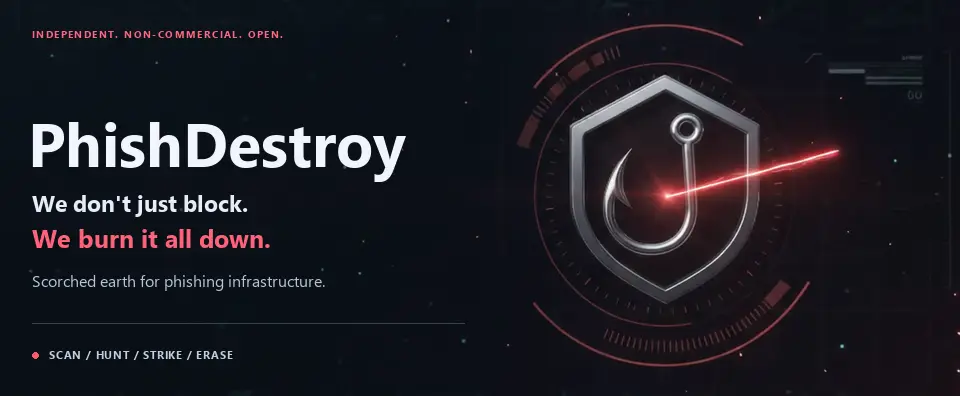
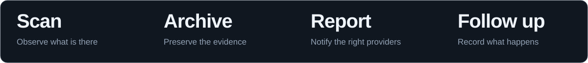

<picture>
  <source media="(max-width: 600px)" srcset="assets/hero-video-mobile.webp">
  
</picture>

  
  
  
  
  
  
  

## Scorched earth for phishing infrastructure.

If you build phishing sites, drain wallets, or knowingly push scam “offers,” we want your operation to fail. Domains flagged. Providers holding the evidence. Every restart costing you more.

We started after watching scam domains survive for years through hundreds of complaints. Cheap to launch, years of victims, no consequences. We're here to wreck that deal. We scan, archive, report and follow up, and keep it all public, so a dead link or a fresh domain doesn't wipe the record.

<picture>
  <source media="(max-width: 600px)" srcset="assets/workflow-mobile.svg">
  
</picture>

<strong>How we hunt</strong>

A domain is a starting point. We follow the certificates, infrastructure, code and money around it.

- **Certificate Transparency (CT) logs:** watch certificate records for new domains, related hostnames and recurring naming patterns.
- **Passive DNS:** trace historical IP addresses, nameservers and DNS changes to follow infrastructure as it moves.
- **Hosting & ASN correlation:** compare network ranges, hosting providers and registration history to map related infrastructure.
- **YARA & phishing-kit fingerprints:** match recurring code and artifacts across captured pages, phishing kits and malware samples.
- **On-chain transaction analysis:** follow wallet addresses and transaction flows to investigate reported theft, drainer activity and connections between cases.
- **Malware reverse engineering:** inspect scripts, APKs and malware samples to understand their behavior and extract indicators for further investigation.

<strong>Five years online, hundreds of complaints</strong>

Registrars say they don't allow scams. Hosts say the same. Yet some of these sites steal for years. So what happened to the complaints?

Often the report didn't show the scam. Cloaking served scanners a harmless page, so we showed what the victim sees: screenshots, archives, even video. Every scam that survives has a reason. We find it, fill the gap in the evidence, report again and log the response.

Scams are against everyone's rules. When the evidence arrives, that should mean something.

<strong>A dead website can take the evidence with it</strong>

We've investigated operations where every site was already gone: no scan, no archive, nothing showing what the domain did. A dead link proves nothing.

So we capture while there's something to capture. Months later an investigator or regulator may need exactly that page. That's also why the database is on GitHub: what we found, when we reported it, and where we might be wrong, all public.

<strong>Who gets the credit?</strong>

We don't have a “delete” button. When a registrar suspends a domain, that's their call. When another researcher cracks a case, that's their work. We don't need the score.

We want scammers losing time and money. Domains that once ran for years now get replaced in days or hours. That's the whole field's work, and we're part of it.

PhishDestroy is unpaid and non-commercial. No money, no obligations, nothing to gain from any particular ban or verdict.

<strong>The hostility is deliberate</strong>

No sympathy for phishing crews, drainer operators, or “affiliates” sending victims into scams. Whatever you call it, you're helping steal.

A scam losing its domain, its traffic or its cash-out route is exactly what we're working for.

But hacked sites are victims too, and our data can be wrong. That's why it's public and why appeals exist. Listed by mistake? We fix it and say sorry.

## Public data. Use it.

Check a domain, download the public list, or follow the evidence in a domain report. Free API. No key.

  
  
  
  

Connect AI tools through [MCP](https://api.destroy.tools/#mcp): `https://api.destroy.tools/mcp`.

## Already in motion

<picture>
  <source media="(max-width: 600px)" srcset="assets/roadmap-mobile.svg">
  
</picture>

**Next:** broader coverage and more AI systems checking the evidence before recommending a site.

<strong>AI should spot the scam before it recommends it</strong>

We've seen AI recommend scam sites. One was [xmrwallet[.]com](https://github.com/phishdestroy/DO-NOT-USE-xmrwallet-com), a wallet scam running since 2016. A decade online, and a model still sent people there.

So we're building records AI can use: IOCs, fingerprints, recurring patterns, scans, archives, and how each scam works. A new domain shouldn't make the same operation unrecognizable.

The goal: a model checks before it recommends, and warns the person before they connect a wallet, paste a seed phrase or send money. Our API and MCP already provide live checks.

## Public feeds & investigations

Our scans, reports and investigation files are here.

  
  

  
  

  
  

  
  

### Investigation dashboards

## If we get it wrong

Wrongly listed? [Tell us.](https://phishdestroy.io/appeals/) No account, no proof of ownership, just the domain and a few words. Clear cases are approved automatically within minutes. If a human needs to look, the public report is hidden during review.

**Every appeal gets 24 hours, max.** No decision by then means it's approved automatically, and the domain is removed from the site, GitHub and the database.

**[Appeal a listing](https://phishdestroy.io/appeals/)** · [Choose an issue template](https://github.com/phishdestroy/destroylist/issues/new/choose)

## A little less serious

<strong>GitHub activity, statistics & trophies</strong>

### Statistics & Activity

  

  

  
  

  

  

  <a href="https://github.com/phishdestroy?tab=overview">View GitHub contribution activity</a>

  

<strong>More stats</strong>

  

  
  

  
  

  <strong>We don’t just block. We burn it all down.</strong> 
  Independent, non-commercial work since 2019. 
  <a href="mailto:github@phishdestroy.io">github@phishdestroy.io</a>

  
  
  
  
  
  
  

